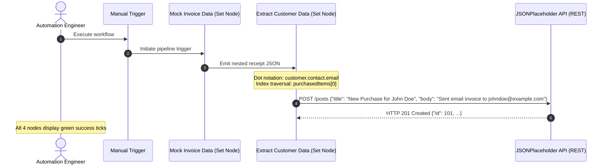

# Topic 3: Working with JSON Data (Step-by-Step Practical Blueprint)

**Course:** n8n Full-Stack Enterprise Automation Engineering  
**Module:** Foundation Automation Architecture & JSON Parsing  
**Author / Engineer:** Abhishek Nikam (`abhishek.n@tayanasolutions.com`)  
**Target Repository:** `https://github.com/abhisheknikam3/topic-03-working-with-json-data`  
**Target Workflow File:** `Topic_03_Working_With_JSON_Data.json`  

---

## 1. Executive Summary & Objective

In production enterprise automation, APIs rarely exchange flat, single-tier key-value pairs. Real-world payloads—from ERP billing records, CRM webhooks, and payment gateway receipts—consist of multi-layered nested objects, variable-length item arrays, and nullable attributes.

This project implements **Topic 3: Working with JSON Data**. It establishes:
1. **Hierarchical Mock Ingestion**: Injecting a multi-tier invoice receipt containing nested objects (`customer.contact.email`) and object arrays (`purchasedItems`).
2. **Dot-Notation Child Traversal**: Extracting deeply nested object keys without data flattening.
3. **Index-Based Array Referencing**: Querying list elements by deterministic zero-based indexes (`purchasedItems[0].name`).
4. **Dynamic Upstream Variable Mapping**: Constructing an outbound HTTP POST payload referencing variables synthesized from upstream nodes.
5. **End-to-End Pipeline Verification**: Validating outbound transmission to the JSONPlaceholder public REST sandbox (`https://jsonplaceholder.typicode.com/posts`) with HTTP 201 Created confirmation.

---

## 2. System Architecture & Flow

### 2.1 Visual Pipeline Topology

```
┌────────────────────────┐
│     Manual Trigger     │
└───────────┬────────────┘
            │
            ▼
┌────────────────────────┐
│   Mock Invoice Data    │  (Edit Fields / Set: Raw JSON)
│  - Ingests Receipt     │  - Nested Customer Object & Array of Items
└───────────┬────────────┘
            │
            ▼
┌────────────────────────┐
│  Extract Customer Data │  (Edit Fields / Set: Manual Mode)
│  - customerEmail       │  -> {{ $json.customer.contact.email }}
│  - fullName            │  -> {{ $json.customer.firstName }} {{ $json.customer.lastName }}
│  - firstItemName       │  -> {{ $json.purchasedItems[0].name }}
│  - firstItemPrice      │  -> {{ $json.purchasedItems[0].price }}
└───────────┬────────────┘
            │
            ▼
┌────────────────────────┐
│ HTTP Request - Post    │  (POST https://jsonplaceholder.typicode.com/posts)
│  - title               │  -> "New Purchase for {{ $json.fullName }}"
│  - body                │  -> "Sent email invoice to {{ $json.customerEmail }}"
└────────────────────────┘
```

### 2.2 Sequence Diagram



---

## 3. Step-by-Step Implementation Guide

### Step 1: Load Nested JSON Payload into Workflow
We initialize a mock receipt simulating an e-commerce order checkout:
1. In n8n, create a new workflow canvas.
2. Add a **Manual Trigger** node.
3. Connect an **Edit Fields (Set)** node and rename it to **`Mock Invoice Data`**.
4. In the node configuration:
   - **Mode:** Select `Raw (Using JSON)`.
   - **JSON:** Paste the following schema:
```json
{
  "receiptId": "REC-9988",
  "customer": {
    "firstName": "John",
    "lastName": "Doe",
    "contact": {
      "email": "johndoe@example.com"
    }
  },
  "purchasedItems": [
    { "name": "Wireless Mouse", "price": 25.99 },
    { "name": "Mechanical Keyboard", "price": 89.99 }
  ],
  "discountCode": null
}
```
5. Click **Test step** to verify the data structure appears in the node output panel.

---

### Step 2: Extract Nested Object Properties using Dot Notation
To query variables located within child objects, dot-notation traverses each parent-child boundary:
1. Connect an **Edit Fields (Set)** node to the output of `Mock Invoice Data`.
2. Rename this node to **`Extract Customer Data`**.
3. In the node configuration:
   - **Mode:** Select `Manual (Using Fields)`.
   - **Field 1 (String):**
     - **Name:** `customerEmail`
     - **Value (Expression):** `{{ $json.customer.contact.email }}`
     - *Preview resolves to:* `"johndoe@example.com"`
   - **Field 2 (String):**
     - **Name:** `fullName`
     - **Value (Expression):** `{{ $json.customer.firstName }} {{ $json.customer.lastName }}`
     - *Preview resolves to:* `"John Doe"`
4. Click **Test step** and verify extracted string attributes appear in the output schema.

---

### Step 3: Reference Array Elements by Index
To fetch items inside a collection or array, standard 0-based indexing is applied:
1. In the same **`Extract Customer Data`** node, click **Add Field**:
   - **Field 3 (String):**
     - **Name:** `firstItemName`
     - **Value (Expression):** `{{ $json.purchasedItems[0].name }}`
     - *Preview resolves to:* `"Wireless Mouse"` (element at index `0`)
   - **Field 4 (Number):**
     - **Name:** `firstItemPrice`
     - **Value (Expression):** `{{ $json.purchasedItems[0].price }}`
     - *Preview resolves to:* `25.99`
2. Click **Test step**. The node output now isolates four clean, flattened business keys:
   - `customerEmail`: `"johndoe@example.com"`
   - `fullName`: `"John Doe"`
   - `firstItemName`: `"Wireless Mouse"`
   - `firstItemPrice`: `25.99`

---

### Step 4: Map Multiple Node Values to an HTTP Payload
Using the extracted fields, we dynamically format an outbound REST payload:
1. Add an **HTTP Request** node connected to the output of `Extract Customer Data`.
2. Rename the node to **`HTTP Request - Post Purchase`**.
3. Configure the parameters:
   - **Method:** `POST`
   - **URL:** `https://jsonplaceholder.typicode.com/posts`
   - **Send Body:** `true` (Toggle ON)
   - **Body Content Type:** `JSON`
   - **Specify Body:** `Using JSON`
   - **JSON Expression:**
```json
{
  "title": "New Purchase for {{ $json.fullName }}",
  "body": "Sent email invoice to {{ $json.customerEmail }}"
}
```
4. Click **Test step**.
5. The downstream server accepts the request and returns `HTTP 201 Created`:
```json
{
  "title": "New Purchase for John Doe",
  "body": "Sent email invoice to johndoe@example.com",
  "id": 101
}
```

---

### Step 5: Save and Execute the Full Workflow
1. Rename the workflow canvas to: **`N8N JSON Traversal Workflow`**.
2. Click **Save** in the top navigation bar.
3. Click **Execute workflow** (or **Test workflow**).
4. All four nodes execute in continuous linear order, displaying green verification checkmarks.

---

## 4. JSON Traversal Reference Matrix

| Query Pattern | Expression Syntax | Target Node Field | Evaluated Result |
| :--- | :--- | :--- | :--- |
| **Top-Level Attribute** | `{{ $json.receiptId }}` | Receipt ID | `"REC-9988"` |
| **Nested 1st-Level Object** | `{{ $json.customer.firstName }}` | First Name | `"John"` |
| **Deeply Nested Object** | `{{ $json.customer.contact.email }}` | Contact Email | `"johndoe@example.com"` |
| **Array Element Attribute (Index 0)** | `{{ $json.purchasedItems[0].name }}` | First Item Name | `"Wireless Mouse"` |
| **Array Numeric Attribute (Index 0)** | `{{ $json.purchasedItems[0].price }}` | First Item Price | `25.99` |
| **Array Element Attribute (Index 1)** | `{{ $json.purchasedItems[1].name }}` | Second Item Name | `"Mechanical Keyboard"` |
| **Nullable Attribute Handling** | `{{ $json.discountCode ?? 'NONE' }}` | Fallback Code | `"NONE"` |

---

## 5. Verification & Test Data

The included workflow JSON file (`Topic_03_Working_With_JSON_Data.json`) contains complete **pre-pinned test data** (`pinData`). You can import the file into any n8n instance and immediately inspect every node's input and output states without running external network calls.

### Verified Response Payload:
```json
{
  "title": "New Purchase for John Doe",
  "body": "Sent email invoice to johndoe@example.com",
  "id": 101
}
```

---

## 6. LMS Assessor Submission Details

- **Student Name:** Abhishek Nikam
- **Email:** `abhishek.n@tayanasolutions.com`
- **Course Module:** Topic 3: Working with JSON Data
- **GitHub Repository:** `https://github.com/abhisheknikam3/topic-03-working-with-json-data`
- **Workflow JSON File:** `Topic_03_Working_With_JSON_Data.json`
- **Documentation Guide:** `README.md` & `README.pdf`
